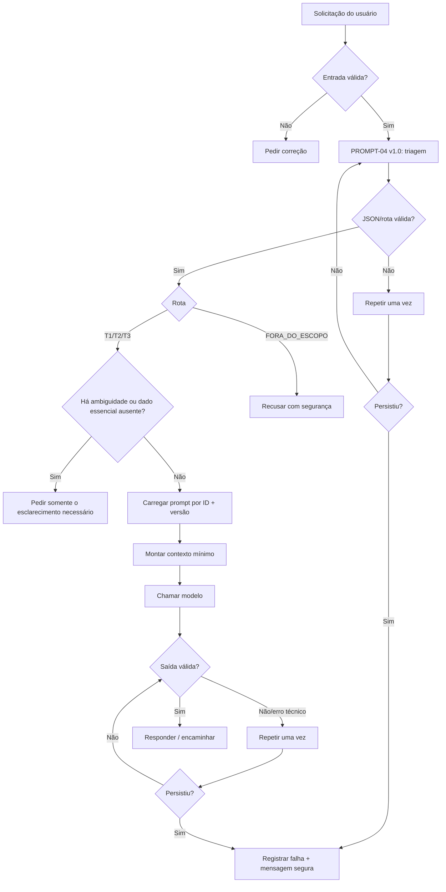

# Fluxo do Protótipo

Decisões principais:
- PROMPT-04 executa somente a triagem.
- PROMPT-01 responde consultas de regra.
- PROMPT-02 compara situações e exige JSON válido.
- PROMPT-03 trata limites, exceções, segurança e encaminhamentos.
- Conversa antiga irrelevante é descartada; apenas a pergunta atual e uma correção útil são usadas.
- Para erro técnico ou saída inválida, existe no máximo uma repetição controlada.
